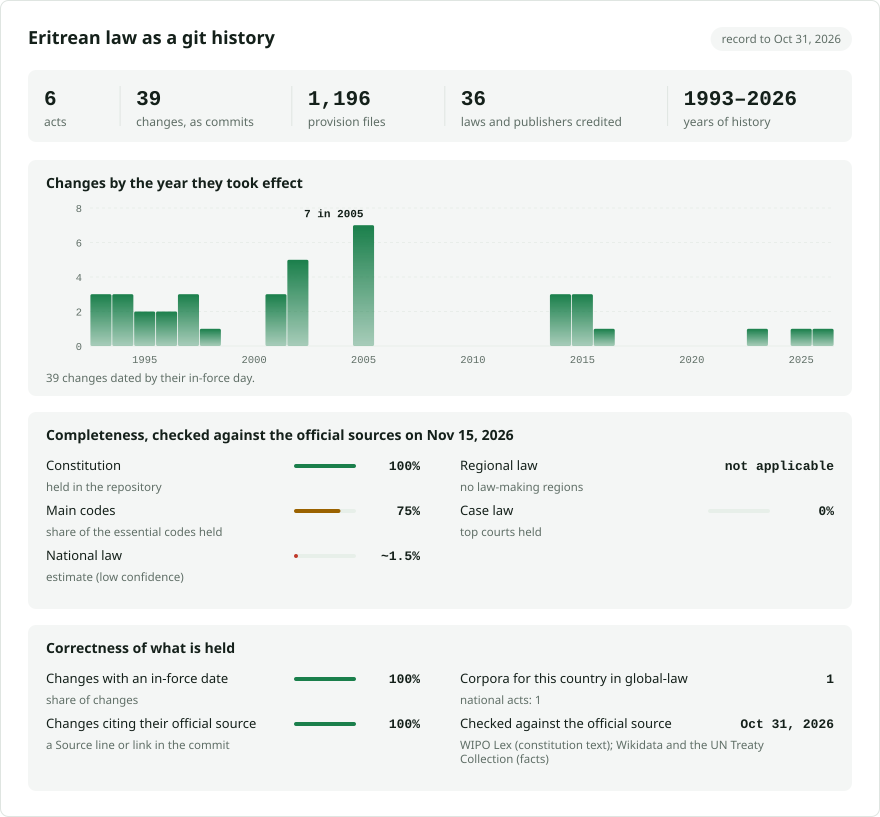

# Eritrea: law history in git

<picture>
<source media="(prefers-color-scheme: dark)" srcset="data/effort-dark.svg">

</picture>

The law of Eritrea as a git history: one file per provision, one commit per version on the day it took effect, and the act that made each change as the commit's author. `git blame` names the act behind every paragraph; `git log` lists every change to an article; picking a date gives the text in force that day.

Part of [lexifina/global-law](https://github.com/lexifina/global-law), one git history for every country's law: this is Eritrea's national law, which global-law reads at `eritrea/national/acts/`.

**What is in it now:** the Constitution of Eritrea as ratified on 23 May 1997 (its preamble and Articles 1 to 59), a text never brought into effect; the Penal Code (preamble and Articles 1 to 396), the Criminal Procedure Code (Articles 1 to 197) and the Civil Procedure Code (Articles 1 to 501) of 2015, each in one version; Eritrea's 33 actions on 30 multilateral treaties, as facts from the UN Treaty Collection; and legal-system facts from Wikidata. Each act's folder has a README listing its provisions.

Each act is a folder (`constitution/`, `penal-code/`, `criminal-procedure-code/`, `civil-procedure-code/`) with one file per article: `constitution/art-01.md` is Article 1 of the Constitution, `penal-code/art-001.md` Article 1 of the Penal Code. In the codes, part, book, title and chapter headings open the article that follows them.

The text is in English, as the copies used print it: the English text of the Constitution and the Ministry of Justice's English editions of the codes. Other language versions are not part of this record.

## Questions as git commands

| Question | Command |
| --- | --- |
| Every change to Article 1 of the Constitution | `git log -p --word-diff -- constitution/art-01.md` |
| Which act wrote each paragraph of Article 1? | `git blame constitution/art-01.md` |
| Every version of the Constitution, with the day each took effect | `git log --grep="^In-force:" --format="%h %(trailers:key=In-force,valueonly,separator=) %an" -- constitution` |
| Article 1 as the record has it on 1 January 2026 | `python tools/on.py 2026-01-01 constitution art-01` |

**Outside git**, we also host this record publicly, for free:

- **[Ask Claude about Eritrean law](https://global-law.lexifina.com/v1/try_claude?country=eritrea)**: opens Claude with a first question ready.
- **[Ask ChatGPT](https://global-law.lexifina.com/v1/try_chatgpt?country=eritrea)**: the same question in ChatGPT.
- **[Search Eritrean law on our site](https://lexifina.com/law?country=eritrea&q=bail)**: a search for "bail", with each provision's text and its versions, no account needed.
- **[Developer REST API](https://global-law.lexifina.com/v1/search_law?query=bail&jurisdiction=eritrea)**: the same search as JSON, with no key. See the [documentation here](https://lexifina.com/api/global-law).

Both assistants read the record through the free Global law connector (MCP, `https://global-law.lexifina.com/mcp`); the first time, the chat gives you the link that adds it. Ask in English.

**Host it yourself easily.** All it takes is git and Python, and the tools run on your machine:

```sh
git clone --depth 1 https://github.com/lexifina/global-law && cd global-law
python3 tools/countries.py add eritrea/national/acts
python3 tools/law.py show 2026-01-01 eritrea/national/acts/constitution/art-01.md
```

Opened in Claude Code, Cursor, VS Code or Codex, the clone also starts a local MCP server with the same tools ([MCP.md](https://github.com/lexifina/global-law/blob/main/MCP.md)).

## Dates

Each commit is dated at noon, Africa/Asmara, on the day the version took effect, and carries it in its `In-force:` trailer:

- the Constitution: 23 May 1997, the day the Constituent Assembly ratified it. It has never been brought into effect, so it has no day of entry into force and the ratification day stands in for one;
- the three codes: 15 May 2015, the date of the Minister of Justice's foreword to the 2015 edition. The Penal Code (Art. 3) and the Civil Procedure Code (Art. 1(1)) come into force on publication in the Gazette of Eritrean Laws, a date the copies used do not print; the Criminal Procedure Code names no day;
- treaty actions: the day of each signature, ratification, accession or acceptance; legal-system facts: the fact's own date where Wikidata gives one, otherwise the day they were read, 30 October 2026.

The Constitution is credited to itself, and each treaty action after the first to that action. Each code is credited to the Ministry of Justice as the oldest version available, since no earlier text is available; the first treaty version (the 1993 acceptance of the WHO Constitution) and the legal-system facts are credited to their sources. The committer is always Lexifina.

## How it is checked

- `tools/check_repo.py` reads every version back from git on the day it took effect and on the day before, and both must match the corpus: 29 versions of 6 acts, 0 mismatches. The results are in [`REPRODUCE.md`](REPRODUCE.md).
- A second build from the same corpus gave identical hashes for all 39 history commits and 63 tags; the SHA-256 of each source PDF is recorded in `data/versions.json`.
- History is append-only: no merge commits, no commit dates that go backwards, none dated after the build, and every commit's trailers parse.

## What it does not show

- **Law in force under the Constitution.** The 1997 Constitution has never been implemented; its files are the text as ratified, not law that applies.
- **The Civil Code of 2015.** The only copy found is a scan with machine-read (OCR) text, so it is not used; of the 2015 codes, only the Penal, Criminal Procedure and Civil Procedure Codes are here.
- **Proclamations and legal notices** of the Gazette of Eritrean Laws, and case law: none yet.
- **Amendments.** Each code is one text, its 2015 edition; the copies record no later amendments.
- **The Penal Code's five annexes** (charts of graduated classes and of aggravating, mitigating and recidivism circumstances), whose layout the PDF's text layer does not keep.
- **Treaty texts, and every treaty.** `treaties/` holds facts only (the action and its date), from a selected set of UN Treaty Collection status pages.

## Sources

| Source | Kind | Past versions | Notes |
| --- | --- | --- | --- |
| [WIPO Lex](https://www.wipo.int/wipolex/en/legislation/details/8937) | The Constitution of Eritrea (ER001), English PDF | no, the text as ratified | An intergovernmental host; the Government publishes no official online copy |
| [Refworld](https://www.refworld.org) (UNHCR) | The Ministry of Justice's 2015 English editions of the Penal, Criminal Procedure and Civil Procedure Codes | no, the 2015 edition | The host of the copies; `REPRODUCE.md` gives each document's address |
| [UN Treaty Collection](https://treaties.un.org/) | Treaty status pages | each action on its date | Facts only, no treaty text |
| [Wikidata](https://www.wikidata.org/wiki/Q986) | Legal-system facts | as read on 30 October 2026 | CC0 1.0 |

## Licence

See [`LICENSE`](LICENSE). Official legislative texts are outside Eritrean copyright: the Civil Code of the State of Eritrea (2015), Article 1161, provides that they "may be freely reproduced" (Article 1651 of the 1993 Provisional Civil Code was to the same effect). The history, commit messages, tables and tools are CC0 1.0.

No AI model wrote, translated or corrected legal text, and none runs when the history is built; the scripts were written by an AI model (see [`REPRODUCE.md`](REPRODUCE.md)).

## More

From [lexifina/global-law](https://github.com/lexifina/global-law):

- [FEATURES.md](https://github.com/lexifina/global-law/blob/main/FEATURES.md): every feature, and what every corpus must support (`git blame`, `law.py`, the MCP tools)
- [FAQ.md](https://github.com/lexifina/global-law/blob/main/FAQ.md): questions and answers · [CONTRIBUTING.md](https://github.com/lexifina/global-law/blob/main/CONTRIBUTING.md): proposing changes · [MCP.md](https://github.com/lexifina/global-law/blob/main/MCP.md): the MCP server · [REPRODUCE.md](https://github.com/lexifina/global-law/blob/main/REPRODUCE.md): how it was built · [CHANGELOG.md](https://github.com/lexifina/global-law/blob/main/CHANGELOG.md)
- [FRESHNESS.md](https://github.com/lexifina/global-law/blob/main/FRESHNESS.md): how current each corpus is · [Monitoring](https://github.com/lexifina/global-law/tree/main/monitoring): whether updates are running · [WATCHING.md](https://github.com/lexifina/global-law/blob/main/WATCHING.md): how each official source is watched for changes
- [performance/](https://github.com/lexifina/global-law/tree/main/performance): how fast the tools are, measured
- [visualisations/](https://github.com/lexifina/global-law/tree/main/visualisations): charts and bridges across the world's law
- [Vulnerabilities](https://github.com/lexifina/global-law/tree/main/vulnerabilities): mistakes in legislation as published
